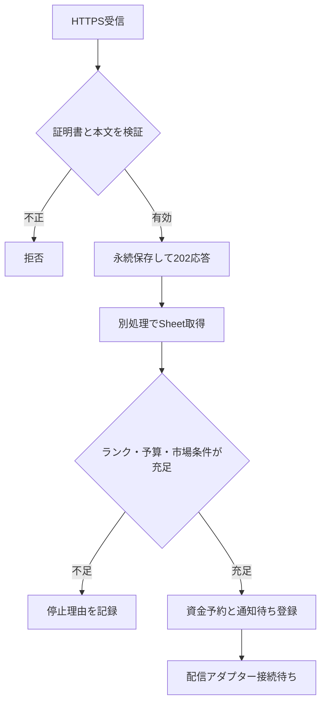

# Webhook・Sheet照合の接続試験（2026-11-12）

## 今回確認した範囲

- `runtime_sheet.py`: 固定したSheet IDと5範囲を読み取り専用GETで取得するアダプター。メタデータ・時刻・100銘柄・TOP10整合性を検査し、入力予算と候補の損切りから判定コンテキストを作る。
- `webhook_receiver.py`: ローカル接続試験専用HTTPSサーバー。TLSクライアント証明書の信頼チェーンとTradingViewの公表された識別情報の両方を要求する。ヘッダーや本文の自己申告では認証しない。
- `webhook_pipeline.py`: 受信をSQLiteへ永続化して即応答し、別処理でSheetと照合。重複、相違する同一ID、期限切れを拒否し、資金予約・通知待ち処理へ渡す。
- ローカル139テスト成功。実際のTLS接続試験、合成データによる通知待ち登録、重複配信防止、外部情報の遅延・欠損時の停止を含む。
- 実Sheetの限定範囲を読み取り、保存したスナップショットから100銘柄・候補10件のコンテキスト生成を確認。新しいGoogle RESTアダプターの認証付きネットワーク実行とは区別する。

## 接続関係



## 本番完了と扱わない項目

1. 受信サーバーは127.0.0.1限定。インターネット公開・常時稼働・負荷対策・監視・復旧は未設定。stdlib HTTPServerを公開運用に転用しない。
2. TradingViewからの実通信、実際の送信側証明書の信頼設定、443番での応答時間・再送動作は未確認。ローカル3秒未満の試験を本番の保証に使わない。
3. TradingViewの証明書はサービスの送信元認証であり、特定の利用者・アラートの所有を証明しない。本人のアラートとの結び付けを本番設計・実測で確認するまで公開有効化しない。
4. Sheet読み取り用の常時稼働認証は未設定。OAuthトークンは安全な実行環境からcallbackで供給する設計。コード・URL・本文・ログに保存しない。
5. 板の取得元と、欠落がないと確認できるイベントカレンダーは未接続。Sheetに近接イベントがあれば停止するが、空欄を「イベントなし」と解釈しない。
6. iPhoneへの実配信アダプターは未接続。テストの疑似配信を実機通知成功とは数えない。
7. 保有・約定が未接続の弱気シグナルはHOLDINGS_NOT_CONNECTED。通知から約定を推測せず、自動発注は行わない。

`go_allowed=false`を維持し、判定用の合成成功ケースも本番GOとして扱わない。100銘柄監視・main・既存クラウド同期を変更しない。

## 検証と再開

```sh
python3 -m unittest discover -s astra/tests
python3 -m compileall -q astra
```

実行環境が決まったら、受信先と安全な認証供給を設定し、本人の実アラートを受信・照合・通知まで追跡する。その後に欠損時停止、再起動後の重複防止、実機到達を確認する。正式バックテストは別途DATA_BLOCKEDのまま。必要な履歴と未使用期間の開始条件は `astra_formal_backtest_protocol_20261112.md` を参照する。

## 一次資料

- https://www.tradingview.com/support/solutions/43000680459-webhook-authentication/
- https://www.tradingview.com/support/solutions/43000529348-how-to-configure-webhook-alerts/
- https://docs.python.org/3.12/library/ssl.html
- https://developers.google.com/workspace/sheets/api/reference/rest/v4/spreadsheets.values/batchGet
